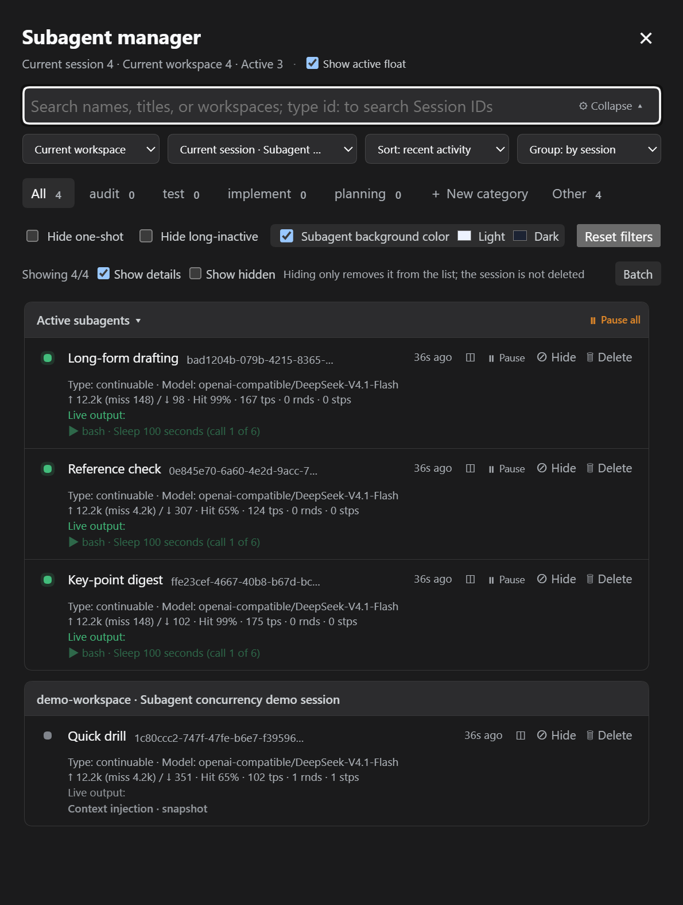
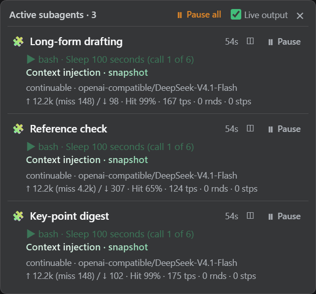

# DSH Subagent Workspace UI

**English** | [中文](README.zh.md)

<p align="center">  </p>
<p align="center"> <a href="https://www.npmjs.com/package/dsh-subagent-workspace-ui"></a> <a href="https://www.npmjs.com/package/dsh-subagent-workspace-ui"></a> <a href="LICENSE"></a> <a href="https://awesome-dsh-plugin.com"></a> <a href="#compatibility"></a> </p>

A Web client plugin that adds a **子代理管理** button to the conversation-header action row. It opens a searchable panel for the subagents currently discovered by the DSH client runtime.

Current release: **v1.9.1** — full history in [`CHANGELOG.md`](https://github.com/miuzel/dsh-subagent-ui/blob/HEAD/CHANGELOG.md) (English) and [`CHANGELOG.zh.md`](https://github.com/miuzel/dsh-subagent-ui/blob/HEAD/CHANGELOG.zh.md) (中文).

## Install in the Web profile

Install the published package from npm into your DSH Web profile:

```bash
dsh plugin --profile web add dsh-subagent-workspace-ui
```

Upgrade to the latest published version:

```bash
dsh plugin --profile web add dsh-subagent-workspace-ui@latest
# or, equivalently:
dsh plugin --profile web update dsh-subagent-workspace-ui
```

Uninstall:

```bash
dsh plugin --profile web remove dsh-subagent-workspace-ui
```

`dsh plugin --profile <name> <args…>` forwards its arguments to pnpm inside that profile, so the usual `add` / `update` / `remove` subcommands apply. No `--allow-build` flag is needed: the published tarball already ships a prebuilt `lib/`, and the package declares no install-time lifecycle scripts.

The bundle includes [`cordis.patch.yml`](cordis.patch.yml), which inserts the manager and shadows exactly one stock slot: `conversation.session.header.lineage` is claimed by a `priority: -1` title-only shadow so DSH's stock `ui-subagent` lineage dropdown stays invisible while this package is installed. The stock `ui-subagent` plugin itself is **left enabled** — this package no longer disables it wholesale, because the sidebar tab it provides is the navigation target of the new "open in the sidebar" button. The shadow renders the session title instead of an empty entry, so the subagent session header keeps its title. Removing the package removes this bundle layer, and the host's `ui-subagent` setting is untouched, so your own configuration is restored as it was. Restart the existing `dsh web` process, then refresh `http://127.0.0.1:3080` after the plugin is available.

If you previously disabled `ui-subagent` manually in `$DSH_HOME/profiles/web/cordis.patch.yml`, you can keep that stanza: it is user-owned and intentionally preserved. The plugin no longer needs (or writes) such a stanza.

Working on a checkout instead of the npm release? See [Local checkout (contributors)](#local-checkout-contributors).

## Features

### Scope: entry, workspace and session

- Compact title-bar trigger shows the active-child count and animated activity dot without opening the panel.
- Defaults to the main session's current workspace and current session, even when the user is viewing a child session.
- Workspace and session selectors support current workspace, all workspaces, named workspaces, current session, and named sessions.
- Show session IDs beside names, compact metadata, token totals, and creation time in the relative-time tooltip.
- Ordinary search matches names, titles and workspace names; the `id:` prefix searches Session IDs only (`id: graph:g-a92e1406`).

### Search, sorting and grouping

- Sort by recent activity, name, or type; recently running children remain near the top after they finish.
- Group by session, workspace, category, type, or no grouping. Session headers show the workspace and parent session name.

### Categories

- Browser-local classification tabs support custom regular expressions. Built-ins include all, other, review, test, implementation, and planning.
- One-shot children carry a compact `⚡ 一次性` badge; continuable children remain visually uncluttered.

### Filtering and hiding

- The filter block (category tabs, scope/session selectors, sorting, grouping, options) opens **collapsed by default**, showing one summary line (`Current workspace · Current session … · All`, then `Sort · recent activity` and `Group · by session`). That summary line is itself the disclosure control — click it, or press Enter/Space (`role=button` / `aria-expanded`) — and the preference is still persisted.
- Filtering and hiding are plugin-local: a hidden child simply leaves the list, no DSH session or workspace file is deleted, and the header counts subtract it. The options row offers hide one-shot, hide long-inactive, show hidden, the show-active-float toggle, a separately configurable subagent background colour for the dark and light themes, and reset filters.

### Pause, continue and one-click pause

- A running continuable child can be paused from its own row, from the active-subagent group header (`⏸ Pause all`, with a confirmation), or from the floating panel.
- An ended continuable row offers **`▶ Continue`** next to pause/hide/delete and sends one **localized** continue instruction into the child (Chinese UI `继续`, English UI `continue`) through the session face the host really exposes: `sessions.retain(…)` → `binding.session.prompt([…], 'queue')` where `retain` exists (0.1.6-alpha.2 on, including 0.1.7-rc.1), and the borrowed `sessions.binding` face on 0.1.5-rc.3, which has no `retain`. Pure capability probing, never a version check: a host without such a face renders no button at all, and running and one-shot rows never show it.

### Batch operations and permanent deletion

- Archive state is local and never deletes a DSH session. Single-row archive actions and a batch mode support shift-selection, select-all, time-based selection (up to 1,000 rows), batch archive, restore, and archive-all.
- Batch mode changes cards into selection targets and hides individual archive/restore actions. The highlighted 完成 button exits batch mode.
- Load catalogs in pages of 40 with an independent wheel-scroll container; batch time selection expands loading up to 1,000 children.

### Live activity and streaming output

- Active children are grouped at the top in a collapsible section. The panel shows the latest two lines of live output, recent tool calls, context injection, command status, and a gray final snapshot after completion — for **every** running row, not only the selected child, because the plugin retains its own session binding instead of borrowing whatever the main view happens to hold.
- Ended rows mark how the last turn finished, from the child's own public read-only `subagentTiming.lastTurnCompleted` projection: a normal end is a **hollow green ring**, an abnormal one (stopped/aborted, error, blocked, a token ceiling …) a **solid red dot**, each with a zh/en hover label. A host that does not publish the projection keeps exactly the previous dot — an unknown end is never shown as a normal one — and a running row keeps its original green dot.

### Opening and inspecting a child

- Open a loaded child at its exact `{ parentSessionId, childSessionId, mode }` address. In normal mode the whole card opens the child; archive controls do not. The navigation tiers are documented under [Compatibility](#compatibility).
- Every row also carries a dedicated **open in the sidebar** button (`◫`) that opens the child as a right-sidebar tab, so the main conversation stays where it is. The button stops propagation (it never triggers the row's default navigation and never toggles batch selection), and it is rendered only when the runtime exposes the sidebar capability: without `ctx.sidebarRight` plus a type that claims the address, the button is hidden entirely; for a single row whose subagent address cannot be resolved it stays visible but disabled with a readable reason. The same button is on the active-subagent floating panel.
- Show each child's current **type and model provider/id** (`provider/model`, plus the reasoning effort when the host publishes one) from the host's public projections only — no new RPC, no model-switch UI. See [Type and model](#type-and-model-read-only-projections).
- Show each child's usage inline, computed with the host's own definitions: `↑ 131.3k (未缓存 39.1k) / ↓ 12.7k · 命中 70% · 104 tps · 3 轮 · 9 步` (English UI: `miss` / `Hit` / `rnds` / `stps`). The `↑` figure is the **billed input** (`uncachedInputTokens + cacheReadTokens + cacheWriteTokens`) and that billed input alone is the cache-hit denominator — exactly what DSH's own composer footer does, so the plugin and the host agree instead of disagreeing by six points. `tps` is `decodeTokens / (decodeMs / 1000)` from the same public `sessionStats` projection. Hovering the row or the floating panel reveals the complete breakdown — total, every bucket, the share, the speed, and the session's LLM / tool / TTFT timings — in the native `title` tooltip.

### Prompt preview inside a subagent session

- A subagent's prompt is usually one long structured markdown brief (a task book, a review checklist). Each user message inside a child session therefore carries a `预览` / `原文` toggle in the official action row: `预览` renders that message's raw text as markdown in place of the official body, `原文` — pinned to the top-right of the rendered block, next to `展开` while the block is folded — puts the official rendering back. Switching either way never moves the layout, and opening a preview scrolls the block's top into view only when it was not already visible.
- The renderer is **self-built and text-only**: headings, nested ordered/unordered lists, bold/italic, inline code, fenced code with its language, nested blockquotes, and links whose target is `http(s)` or relative. Every element is created as a text node — no third-party markdown library, no `dangerouslySetInnerHTML`, no `innerHTML` — so an injected `<script>` and a `javascript:` / `data:` link stay inert text.
- Long bodies start folded and `展开` / `收起` toggles them; a 20 000-character body stays responsive. Activation binds to `pointerdown` (a host that rebuilds the action row between press and release cannot lose it) with a per-message guard against a double toggle, while `click` keeps Enter/Space working.
- The official `conversation.chat.node` renderer is never taken over: the plugin adds a second, **headless** cell to the same slot, so a host change costs that one cell rather than the conversation. A non-subagent session gets no preview at all, and the text source is documented under [Prompt text](#prompt-text-read-from-the-childs-user-messages).

## Screenshot guide

Both screenshots were taken on the `1.7.0-dev` line (commit `79d9d0f`) against a real dsh **0.1.6-alpha.2** instance in its dark theme. The session had four background subagents at once — three still running and one already finished — so every row could be shown with its real type, model and usage figures. The pair below is the English UI; the Chinese UI pair is in [`README.zh.md`](README.zh.md).





### Legend

1. **Header** — panel title, `Current session n · Current workspace n · Active n`, the show-active-float toggle, and the close action.
2. **Search and scope row** — ordinary name/title/workspace search, with `id: xxx` reserved for Session ID search; workspace, session, sorting, and grouping selectors stay on one compact row.
3. **Classification row** (once the filter block is expanded) — built-in and custom categories with live counts, custom-category creation and deletion inside the same tab frame.
4. **Filter block** — collapsed by default into a single summary line (`Current workspace · Current session … · All`, plus `Sort · recent activity` and `Group · by session`); clicking that summary line expands or collapses the block and Enter/Space do the same (`role=button` / `aria-expanded`). Expanding it reveals the classification row above, the workspace/session/sort/grouping selectors, and the options row: hide one-shot, hide long-inactive, subagent background colour (light/dark), and reset filters. The preference is still persisted.
5. **Summary row** — `Showing n/m`, show details, show hidden, and the batch-mode entry.
6. **Active subagents group** — pinned to the top and collapsible, with `Pause all`; each row carries the status dot (a green dot while running, a hollow green ring or a solid red dot once ended, according to how it ended), the name, the Session ID, the relative activity time, and the `◫` open-in-the-sidebar, `⏸ Pause`, `▶ Continue`, `⊘ Hide` and `🗑 Delete` actions.
7. **Detail block** — `Type: … · Model: …` straight from the host's read-only projections, then the official usage line `↑ billed (miss …) / ↓ output · Hit n% · n tps · n rnds · n stps`; a running child also shows its latest live-output lines, while a finished child keeps its final snapshot.
8. **Floating panel** — the running children of the current session in a compact always-on-top card, each with its live output, usage line and stop button; it appears whenever at least one child is running and the manager panel is closed. While it is shown it keeps every running child it lists live, independently of which child the main view has selected.

## Runtime data boundary

The public DSH Web session store exposes subagent summaries that have been discovered in the current browser runtime. It deliberately does not expose a global historical subagent index or a mode for every unvisited child. Therefore this first plugin version manages the discovered catalog; rows whose type is not yet loaded remain visible and searchable and fall back to DSH's retained session navigation. Exact catalog navigation is used automatically as soon as DSH supplies the address and mode.

A full persistent workspace-wide archive view requires a host-side catalog RPC (or an upstream DSH API) that enumerates every child address and its mode. The public `SessionSummary` exposes no prompt, so the prompt is never read from it: the preview's text comes from the child session's own `user/message` bodies through the same retained binding and is documented in [Prompt text](#prompt-text-read-from-the-childs-user-messages); **type and model** come from the public projections documented in [Type and model](#type-and-model-read-only-projections). Live output and tool/context activity are read from a bound session automatically: on dsh **0.1.2-alpha.2** they are derived from the raw `binding.eventSource` event stream (showing the tool description or target filename), while older hosts (e.g. **0.1.1-rc.2**) fall back to `session.getSnapshot().chat.legacy`. On hosts with the retain contract (**0.1.6-alpha.2** and on) the plugin first **retains** each running child itself — `sessions.binding(id)` merely borrows a binding somebody else retained, so without retaining, only the child the main view had selected ever streamed. Retention is bounded to 8 children (the float first, then the panel's rendered running rows, most recently active first) and is released as soon as a row stops rendering or stops running, when a surface closes, or when the plugin is disposed; a child beyond the cap, and any host without `retain`, falls back to the borrowed binding and then to the durable summary. Capability detection selects the path (never a version check), so the plugin stays forward compatible. The UI is isolated in [`lib/client.js`](lib/client.js), so it can switch to a richer source without changing the panel interaction model.

Archive, category and recent-use order are kept in browser `localStorage`; nothing is ever written into the DSH session log.

### Prompt text (read from the child's user messages)

The prompt shown by the preview is read from the child session's own **`user/message` events**, through the same retained binding the live-output features use, and only for a session the plugin is currently rendering. `SessionSummary.prompt` is still not a source — that projection carries no prompt at all:

- A message node is matched to its record **by message id**; the node key's `<anchor>` is a feed counter, not `event.seq`, and is used only when a key carries no id at all. Positional filling never crosses into an addressable node.
- A node whose own record is outside the retained event window is not guessed from a neighbour: that node's **own** body is read from the DOM, and wherever the record is available the result is asserted against it (length plus a rolling hash).
- Reading the DOM merges every body fragment of that node in document order — marked and unmarked — through a walk that drops chrome (clock, action buttons, card title, footer). Nothing is written back: the session log is never modified, and archive/category state stays in `localStorage`.

### Type and model (read-only projections)

A child's type and model come from public host projections. The plugin adds no RPC and writes no state:

```text
# type: one reader, read-only catalog and identity rungs, resolved in this order
ctx.sessions.list.getSnapshot().subagentsByParent[parentId].entries           # dsh ..0.1.6-alpha.2
→ entry.mode                       # rung 1: discovered catalog entry (present once that parent's catalog was pulled)
ctx.sessions.list.getSnapshot().byId[parentId].projectionValues.subagentCatalog   # dsh 0.1.7-rc.1..
→ entry.mode                       # rung 1': the parent's own catalog projection (same direct children, catalog event order)
ctx.sessions.list.getSnapshot().byId[childId].projectionValues.subagent
→ { mode, label, seq } | null      # rung 2: the child's own identity projection (pushed on the live-control stream)
→ displayed value = rung 1 ?? rung 1' ?? rung 2   # all silent = the existing `typeLoading` text

# model: the session projection modelSelection (probed by key; unreadable = the host does not publish it)
ctx.sessions.list.getSnapshot().byId[childId].projectionValues.modelSelection
→ { lastUsed, next }               # next = pending selection ?? lastUsed
→ displayed value = next ?? lastUsed   # { provider, model, reasoningEffort? }
```

The display rules are identical on all three surfaces and differ only in density:

| Surface | Rendering |
| --- | --- |
| List-row meta line | no model (unchanged: relative time and summary stats) |
| Card detail row (expanded by default) | `Type: continuable · Model: newapi-test/DeepSeek-V4.1-Flash · high` |
| Active-subagent float | compact: `continuable · newapi-test/DeepSeek-V4.1-Flash · high` |

- `reasoningEffort` is appended **only when the host supplies it** (` · high`); no placeholder is rendered otherwise.
- All three surfaces share one `modelText()` reader, so the source, the precedence (`next ?? lastUsed`), and the fallback are the same everywhere; the float only drops the field labels.
- The type is resolved by one reader (`childModeOf`) with one fallback order, shared by the detail row, the row badge and the float: the discovered catalog entry first, then the child's own `subagent` identity projection. The catalog itself has two generations — `subagentsByParent[parentId].entries` up to **0.1.6-alpha.2**, and the parent session's own `projectionValues.subagentCatalog` from **0.1.7-rc.1** on (with `projectionsBySession[parentId].values.subagentCatalog` as a defensive fallback) — and the legacy source wins whenever a host publishes both, so an older host reads exactly what it read before. Rung 2 is what makes the type correct on a freshly loaded page **without** opening the manager panel — the host pushes that projection on the live-control stream and on every session-added summary, while rung 1 only arrives when a parent's catalog is pulled (opening the panel is one such pull). Both rungs silent keeps the existing fallback: the panel and the float show **type loading…** (`类型待加载` in Chinese), never a blank or a `null`.
- When the host does not publish the projection (e.g. **0.1.1-rc.2**), when the projection value is empty, or when provider/model is an empty string, the plugin shows the explicit fallback **model unknown** (`模型未知` in Chinese) instead of a blank or `null/null`. That fallback has its own i18n key (`modelUnknown`) and never reuses `typeLoading`: on an old host the two fields degrade independently (observed row: `Type: type loading… · Model: model unknown`).
- **Read-only, no switching**: the plugin calls no model write API such as `selectedModel` and offers no model-switch UI; the official SDK marks model selection as unavailable for addressed subagent sessions (`model selection is unavailable for addressed subagent sessions`).

## Compatibility

v1.8.0 and later support dsh **0.1.5-rc.3**, **0.1.6-alpha.2**, **0.1.7-rc.1**, **0.1.7-rc.2** and **0.2.0-rc.1** and stay backward compatible with all DeepSeek Harness versions. Those hosts span two API tiers — 0.1.5-rc.3 and 0.1.6-alpha.2 still publish `subagentsByParent`, `refreshSubagents` and `setSubagentCatalogOpen`, while 0.1.7-rc.1 **removed** `sessions.setSubagentCatalogOpen`, **renamed** `refreshSubagents(parentSessionId)` to `refreshProjections(sessionId)`, and **replaced** `SessionListState.subagentsByParent` with the parent session's own `subagentCatalog` projection. Every call site probes for the capability it needs, so both generations work and no version number is ever compared.

**0.2.0-rc.1** was checked the same way — package by package against **0.1.7-rc.1** (23 host packages plus the CLI, app boot and the web frontend), not against its release notes — and it needs **no adaptation** either: no host face this plugin reads changed structurally. The two slot declarations it registers, the module-loader shell and its seeded `require` keys, the `subagentCatalog` / `subagent` / `subagentTiming` projections (including the generational `lastTurnCompleted` field), `subagentAddress` / `openResource` / `candidates`, the `dsh plugin --profile web add` flow and all 21 `--dsw-*` tokens this plugin uses are unchanged or purely additive; the only contract addition is an optional `fork(onCreated)` the plugin never calls, and the stock web graph dropping its `ui-schedule` row does not touch this plugin or its slot shadow. Two differences are visible but not breaking: one dark-theme token the panel and the floating card use for their glass surface changed value, and the sidebar services appear **even later** than on 0.1.7-rc.1 (see “Open in the sidebar” below).

A smoke run on **0.2.0-rc.1** renders the same panel: on a parent session with six catalog children the manager lists all six rows with their catalog labels, `Type: continuable` on every row and an enabled `◫` on every row, and each child session that gets mounted shows its ended row as the hollow green ring with its own model and usage figures — line for line the same as the **0.1.7-rc.1** run over the same session data, and a click on `◫` opens that child as a right-sidebar tab on both.

A smoke run on **0.1.5-rc.3** shows no degradation on that line: on a fresh instance with one running child the manager opens on the live session with the child's catalog label, `Type: continuable`, the concrete model id, `◫` on the row, the pause/hide/delete actions, the live-output section rendering that child's running `bash` tool, and the usage figures — with no error from this plugin in the console.

**0.1.7-rc.2** needs no adaptation either, and it exposed one thing the earlier matrix had missed: the stock `ui-subagent` plugin registers **two** header entries, not one. Besides the `conversation.session.header.lineage` dropdown, **0.1.7-rc.1** added a second registration in `conversation.session.header.actions` (`id: "subagent-catalog"`, `order: -30`) that draws the official “N subagents” count dropdown as soon as the current session's `subagentCatalog` projection is loaded. Because that slot is a `list` slot whose cells are keyed by `id`, the manager's own `subagent-workspace-manager` cell never competed with it, so both entries could show side by side — the plugin now shadows that cell too (`priority: -1`, rendering `null`), exactly as it shadows the lineage slot, and either shadow degrades to “official entry visible” if a host ever occupies the same cell at that priority. Verified on **0.1.7-rc.1**, **0.1.7-rc.2** and **0.2.0-rc.1** against the same six-child fixture: the header shows only `🧩 Subagents 0/6`, the six-row panel opens, and each row's `◫` still opens that child as the stock `subagentchat` right-sidebar tab. On **0.1.5-rc.3** and **0.1.6-alpha.2** — which have no such stock registration — the extra shadow cell adds no element to the header and raises no error.

### Session navigation (three capability tiers)

```text
# dsh 0.1.2-alpha.5 .. 0.1.6-alpha.1: the session controller entry points
ctx.sessions.openSubagent(address)   # exact child address
ctx.sessions.open(sessionId)         # retained session navigation

# dsh 0.1.6-alpha.2 and later: the workspace navigation service
ctx.get('uiWorkspace').openSession({ parentSessionId, childSessionId, mode } | sessionId)

# neither is available: the click reports that the host has no session navigation API
```

`uiWorkspace` is read through `ctx.get('uiWorkspace')`, never through a required injection, so hosts that do not register the service (everything before **0.1.2-alpha.5**) still load and keep using the session-controller path, while hosts that removed `openSubagent`/`open` (**0.1.6-alpha.2**) use the workspace service. **The probe order follows the argument shape, not the version**: `sessions.openSubagent` accepts an address object on every host that has it, whereas `uiWorkspace.openSession` only accepts a `SessionTarget` from **0.1.6-alpha.2** on — on **0.1.5-alpha.2 … 0.1.6-alpha.1** it is `openSession(sessionId)` and routes through `sessions.open(id)`, which throws on an address. The session-controller tier is therefore tried first and the workspace service is the fallback. Within the controller tier the exact `{ parentSessionId, childSessionId, mode }` address is used first and only a missing mode/child falls back to plain session navigation, because `openSubagent` rejects addresses that are not healthy catalog children. The 0.1.2-series capability paths (live output via `binding.eventSource`, chat-tab switch via slot `actions`) remain the primary branches, and the **0.1.1-rc.2** legacy fallbacks (`chat.legacy` snapshot) are unchanged.

### Open in the sidebar (◫ button)

The **open in the sidebar** button follows the same rule — capability detection, never a version check:

```text
# button hidden entirely unless every piece is present
ctx.get('sidebarRight')        → typeof openResource === 'function'
ctx.get('sidebarRightTabs')    → typeof candidates === 'function'
ctx.sessions.subagentAddress   → typeof function   (per-row address lookup)

# per row: address = subagentAddress(row.id) rebuilt into the canonical
# dsh-resource://subagentchat/session/<child>?parent=…&mode=… form and then
# validated with sidebarRightTabs.candidates(address) — the registry's own
# "would any type open this?" check. Empty ⇒ the row's button renders disabled
# with a readable reason instead of throwing.
```

Both faces are resolved **per row and per click, never once at activation**: dsh **0.1.7-rc.1** registers `sidebarRight`/`sidebarRightTabs` only *after* a plugin's `apply` has run — on **0.1.6-alpha.2** they are already present when `apply` runs — so a probe performed once at activation hides the whole `◫` column on the newer host while leaving the older one untouched. dsh **0.2.0-rc.1** pushes that window further out still: its `ui-sidebar-right` now also injects `shortcuts`, so it waits for one more service before it publishes those two faces. The per-row, per-click resolution is what keeps the `◫` column rendered on all of these hosts.

Adding the sidebar capability does not change the navigation probe above: the row's default click still walks the same three tiers, and the new button never touches them.

Opening a subagent in the right sidebar uses DSH's own `subagentchat` right-sidebar tab, so the pane is a *session view*: the subagent session's composer there is DSH's official read-only composer (`一次性子代理记录` / "one-shot subagent record") rather than this plugin's UI. That is expected, and it is the only official way to read a child session without leaving the main conversation.

## Development and validation

The client bundle `lib/client.js` is **generated from the TypeScript sources** in [`src/client/`](src/client/) — edit those, never the bundle, then rebuild:

```bash
pnpm install      # dev deps: sucrase + typescript
pnpm run build    # scripts/build.mjs -> lib/client.js
pnpm run check    # build + tsc --noEmit + node --check lib/index.js + bundle freshness gate
```

`pnpm run verify:build` compares the generated bundle with the hand-written pre-refactor bundle (git ref `v1.3.4`) up to insignificant whitespace, using token-level and line-level comparison. After the migration it doubles as a delta viewer that prints the exact differences of any intentional change.

### Local checkout (contributors)

To iterate on a clone instead of the npm release, install the working tree into the Web profile from the repository root:

```bash
dsh plugin --profile web add file:.
```

Profile installs are store copies, so after editing `src/client/*.ts` you must run `pnpm run build` and re-add the plugin (or run `./test.sh`) before the Web UI can pick the change up. The host-entry (`lib/index.js`) path always needs a `dsh web` restart. The same contributor loop is documented in [`AGENTS.md`](AGENTS.md).

### Smoke test (any dsh version)

```bash
./test.sh                                      # local dsh, port 8084
./test.sh 8085                                 # explicit port
DSH_VERSION=0.1.6-alpha.2 ./test.sh            # pnpx @deepseek-ai/dsh@0.1.6-alpha.2 (via proxychains4 -q)
DSH_VERSION=0.1.1-rc.2 ./test.sh               # legacy-API smoke on an old dsh
DSH_PLUGIN_DIR=.worktrees/x ./test.sh          # smoke another checkout's bundle
```

The script always uses an isolated `DSH_HOME` (`$HOME/tmp/dsh-test`, override with `DSH_SMOKE_HOME=…`) and refuses to touch the real `~/.dsh` profile. With `DSH_VERSION` set it runs `pnpx @deepseek-ai/dsh@<version>`; pnpm 12 ignores dependency lifecycle scripts by default, so the script passes `--allow-build=<pkg>` for dsh's native dependencies (`DSH_ALLOW_BUILDS=…` overrides the list).

## Release notes

Full release notes — every version, newest first — live in the changelog:

- [`CHANGELOG.md`](https://github.com/miuzel/dsh-subagent-ui/blob/HEAD/CHANGELOG.md) — English, back to v1.3.2.
- [`CHANGELOG.zh.md`](https://github.com/miuzel/dsh-subagent-ui/blob/HEAD/CHANGELOG.zh.md) — 中文完整版, back to v1.0.1.

## Acknowledgements

- UI localization (zh/en) contributed by [@Marcuss2](https://github.com/Marcuss2) via [PR #1](https://github.com/miuzel/dsh-subagent-ui/pull/1) — many thanks!
- Subagent permanent deletion and session cleanup design inspired by and referencing [@heiheiha798/dsh-plugin-subagent-delete](https://github.com/heiheiha798/dsh-plugin-subagent-delete).
