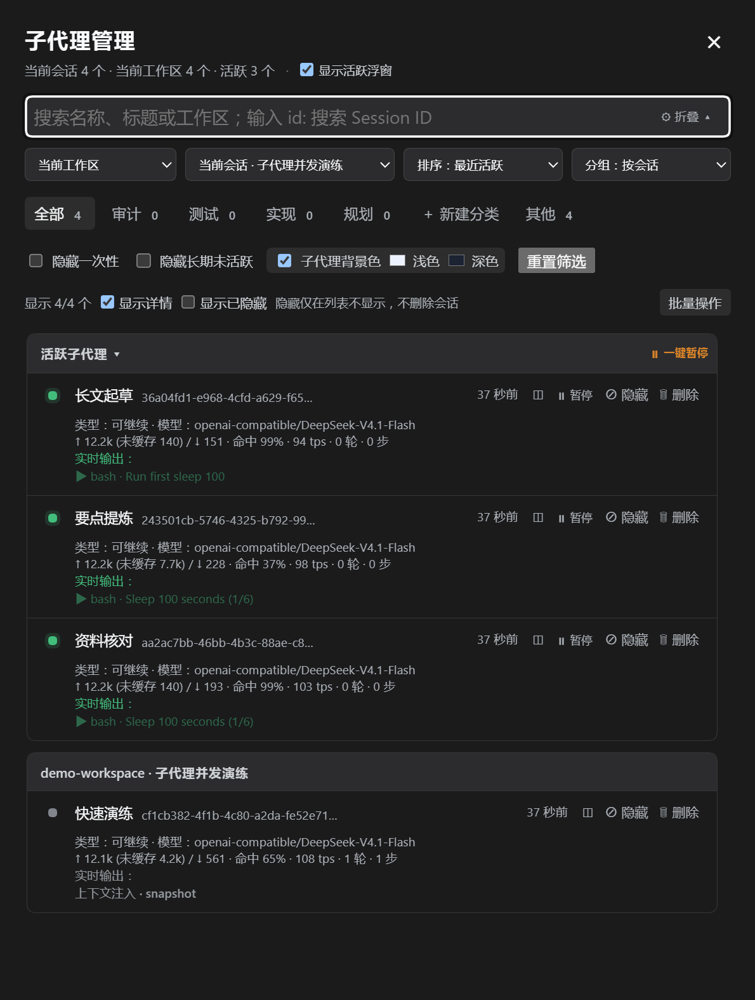
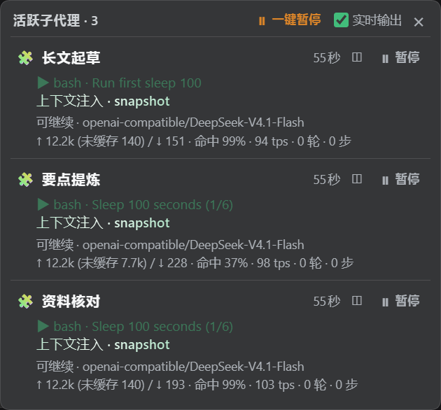

# DSH 子代理工作区管理器

[English](README.md) | **中文**

<p align="center">  </p>
<p align="center"> <a href="https://www.npmjs.com/package/dsh-subagent-workspace-ui"></a> <a href="https://www.npmjs.com/package/dsh-subagent-workspace-ui"></a> <a href="LICENSE"></a> <a href="https://awesome-dsh-plugin.com"></a> </p>

面向 DeepSeek Harness Web 的子代理管理插件。插件在会话标题栏提供一个紧凑的 `🧩 子代理 active/total` 入口，用于搜索、筛选、分组、排序、查看和批量归档当前运行时已发现的子代理。

当前发布版本：**v1.9.1** —— 完整历史见 [`CHANGELOG.zh.md`](https://github.com/miuzel/dsh-subagent-ui/blob/HEAD/CHANGELOG.zh.md)（中文，回溯至 v1.0.1）与 [`CHANGELOG.md`](https://github.com/miuzel/dsh-subagent-ui/blob/HEAD/CHANGELOG.md)（English）。

## 安装

从 npm 安装已发布的包到 DSH Web profile：

```bash
dsh plugin --profile web add dsh-subagent-workspace-ui
```

升级到最新发布版本：

```bash
dsh plugin --profile web add dsh-subagent-workspace-ui@latest
# 或者等价地：
dsh plugin --profile web update dsh-subagent-workspace-ui
```

卸载：

```bash
dsh plugin --profile web remove dsh-subagent-workspace-ui
```

`dsh plugin --profile <name> <参数…>` 会把参数转发给该 profile 内的 pnpm，因此 `add` / `update` / `remove` 等子命令按常规语义生效。**不需要 `--allow-build`**：发布 tarball 内含预构建的 `lib/`，且本包没有安装期生命周期脚本。

插件 bundle 会自动加载 [`cordis.patch.yml`](cordis.patch.yml)：安装期间插入管理器，并且**只遮蔽一个 slot**——用 `priority: -1` 的**标题位遮蔽**占用 `conversation.session.header.lineage`，从而让 DSH 自带的 `ui-subagent` 血统下拉保持不可见。自带 `ui-subagent` 插件本身**保持启用**（本插件不再整体禁用它），因为新版「在侧边栏打开」按钮正是复用它提供的 `subagentchat` 右侧栏标签页。该遮蔽渲染的是会话标题而不是空内容，所以子代理会话标题不会消失。卸载插件后，这层 bundle patch 会被移除，宿主的 `ui-subagent` 设置从未被改动，恢复如初。请重启现有的 `dsh web` 进程，然后刷新：

```text
http://127.0.0.1:3080
```

如果之前在 `$DSH_HOME/profiles/web/cordis.patch.yml` 中手动禁用了 `ui-subagent`，那条配置属于用户所有，插件不会覆盖、也不会依赖它——可以保留。

要在本地 checkout 上开发而不是用 npm 发布版？见[本地 checkout（贡献者）](#本地-checkout贡献者)。

## 主要功能

### 范围：标题栏入口、工作区与会话

- 标题栏入口显示活跃数 / 总数与活动动画点，不打开面板也能看到运行状态。
- 默认选择当前工作区。
- 默认选择当前主会话；即使当前页面已经进入某个子代理，会话管理器仍然以最上层主会话为基准。
- 工作区下拉框支持：
  - 当前工作区
  - 全部工作区
  - 具体工作区列表
- 会话下拉框支持：
  - 全部会话
  - 当前工作区内的会话
  - 当前会话标记
- 支持通过 `id:` 前缀单独搜索 Session ID，例如：

  ```text
  id: graph:g-a92e1406
  ```

  普通搜索不会把 Session ID 或父会话 ID 当作搜索字段。

### 搜索、排序与分组

- 普通搜索匹配子代理名称、标题和工作区名称。
- 支持按以下方式排序：
  - 最近活跃
  - 名字
  - 类型
- “最近活跃”优先使用 DSH 提供的 `updatedAt`。
- 最近进入运行状态的子代理会被记录，即使运行结束后仍会保持靠前显示。
- 支持以下分组：
  - 按会话
  - 按工作区
  - 按分类
  - 按类型
  - 不分组
- 按会话分组时，分组标题显示“工作区 · 会话名称”，卡片中不再重复显示相同的归属信息。
- 活跃子代理单独置顶，并可折叠。

### 分类标签

内置分类包括：

- 全部
- 其他
- 审计
- 测试
- 实现
- 规划

分类标签会显示当前数量，超过 99 个显示为 `99+`。

用户可以创建自定义正则分类。自定义分类支持：

- 标签内显示数量。
- 未选中时不显示选中高亮。
- 删除前确认。
- 删除按钮与分类名称处于同一个标签框内。

一次性子代理名称后显示紧凑标签：

```text
⚡ 一次性
```

可继续子代理不显示额外类型标签。

### 过滤与隐藏

支持以下过滤与个性化选项：

- 隐藏一次性
- 隐藏长期未活跃
- 显示已隐藏
- 显示活跃浮窗
- **子代理背景色自定义**：可开启/关闭子代理会话的独立背景色，支持分别配置深色主题与浅色主题下的背景色，进入子代理时一目了然。
- 重置筛选

隐藏是插件本地状态，只在列表不显示子代理，不会删除 DSH 会话或工作区文件。默认情况下：

- 列表不显示已隐藏子代理。
- 标题栏入口的总数和活跃数扣除已隐藏子代理。
- 勾选“隐藏一次性”后，入口按钮统计也会扣除一次性子代理。
- 卡片右侧提供 **👁 隐藏** / **🙈 取消隐藏** 按钮。

### 暂停、继续与一键暂停

- **浮窗一键暂停**：活跃子代理浮窗头部提供“⏸ 一键暂停”按钮，点击并二次确认后批量暂停所有活跃的可继续子代理。
- **浮窗单项暂停**：浮窗内每个正在运行的可继续子代理卡片均有“⏸ 暂停”按钮，点击确认后暂停该子代理。
- **管理面板单项暂停**：列表和活跃分组中的每个运行中可继续子代理均有“⏸ 暂停”按钮。
- **管理面板一键暂停**：“活跃子代理”折叠分组头部右侧提供“⏸ 一键暂停”按钮，支持一键暂停全部活跃子代理。
- **继续已结束的子代理**：已结束（非运行中）的可继续子代理行在操作区显示“▶ 继续”，点击后向该子代理发送一条**本地化**的继续指令（中文界面「继续」、英文界面 “continue”），让它接着跑。运行中与一次性子代理的行不显示该按钮；宿主没有该能力时**按钮不渲染**（纯能力探测，从不比较版本号）。管理器面板本身就在父会话 header 里，所以“父会话 agent 必须存活”这一前提在正常使用下天然满足；父会话不可用时只在控制台告警，不会把异常抛给用户。

### 批量操作与永久删除

点击结果统计右侧的“批量操作”进入批量模式。批量模式下：

- 整张子代理卡片都变为选择区域。
- 点击卡片任意位置即可选中或取消选中。
- 复选框支持普通选择和 Shift 连续选择。
- 不会跳转到子代理会话。
- 隐藏单个操作按钮。
- 已隐藏项显示 `已隐藏` 标签。
- “完成”按钮使用高亮样式，点击后退出批量模式。

可用批量操作：

- 全选当前筛选结果。
- 清空选择。
- 选择 N 小时以前的子代理。
- 批量隐藏 / 批量取消隐藏 / 一键全部隐藏。
- **批量删除**：将选中的子代理永久从磁盘、投影缓存、工作区索引和内存会话中彻底销毁。
- **一键删除全部**：一键彻底清理当前视图中的所有子代理。

单项卡片在非批量模式下也提供 **🗑 删除** 按钮，点击确认后彻底销毁。所有删除操作完全由人类用户在 UI 侧主动操作，子代理不会也不需要耗费时间去感知或调用工具。

### 实时活动与流式输出

当 DSH 会话 API 提供绑定会话与实时事件时，卡片底部会显示实时活动：

- 最新两行模型文本或思考文本。
- 正在运行的工具调用，例如 `Read`、`Bash`（优先显示工具说明或目标文件名）。
- 最近完成的工具调用及成功/失败状态。
- 上下文注入，例如 `skill-catalog` 或插件系统提示。
- 命令状态。

实时输出具有金属光泽扫光动效；子代理结束后保留最后显示快照，并变为灰色。输出区域最多显示两行，避免持续滚动导致内容难以阅读。

**每个运行中的子代理都有自己的实时流（dsh 0.1.6-alpha.2 起）**：宿主 `sessions.binding(id)` 的契约是「借用已被保留的绑定，不创建保留」，而官方客户端里唯一保留会话的是主会话视图——它只保留**当前选中**的那一个。因此插件改为自己成为保留者：`sessions.retain(target, { source: 'subagentWorkspaceUi' })` 拿到 `SessionReference`，用 `reference.binding` 取 `session` / `eventSource`，不再依赖「是否被选中」。

保留是有界且成对释放的：

- **浮窗常驻**：浮窗显示期间，对其中每个运行中的子代理各保留一个引用。
- **面板仅可见行**：管理面板只对当前筛选/分组后**实际渲染出来**的运行中行保留，打开面板不会去加载全部历史子代理。
- **上限 8**：浮窗优先，其次按最近活动优先；超出上限的运行中行按快照显示（仍有用量等持久信息）。
- **成对释放**：行不再渲染、子代理转为非运行态、浮窗/面板关闭或插件卸载时调用 `release()`；重复释放幂等。

**兼容两个 API 代际（自动探测）**：

- dsh **0.1.6-alpha.2** 起：自己 `retain`（`reference.binding.eventSource` 原始 `SessionEvent` 事件流）；宿主未提供 `retain` 时回退借用式 `binding(id)`。
- dsh **0.1.2-alpha.2**：`binding.eventSource`（原始 `SessionEvent` 事件流）推导实时输出。
- dsh **0.1.1-rc.2** 及更早：回退 `session.getSnapshot().chat.legacy`（对话快照）路径。

按能力探测自动切换（不判版本号），向前兼容，老版本行为不变；两条路径都拿不到绑定时，界面回退到持久化摘要。

已结束的行还会用状态点区分结束方式：**正常结束为空心绿环，异常结束（⏸ 停止/aborted、error、blocked、max-tokens 等）为实心红点**，hover 显示「正常结束 / 异常结束」文字（zh+en）。判定只读子代理自身的公共只读投影 `subagentTiming.lastTurnCompleted`（宿主仅在 `turn/end` 写入、`turn/start` 删除）；宿主不提供该投影时**保持原样**，绝不把“未知”显示成“正常”，运行中的行保持原绿点。

### 打开与查看子代理

- **精确地址打开**：点击卡片把子代理打开到主对话区，地址为 `{ parentSessionId, childSessionId, mode }`；批量模式下卡片整体变为选择区域，归档控件不会触发跳转。降级顺序见「打开子代理会话的三级能力探测」。
- **`◫` 在右侧边栏打开**：不离开主对话即可把子代理开成 DSH 自带的 `subagentchat` 标签页；纯能力探测，且按行、按次解析。详见「在右侧边栏打开子代理（`◫` 按钮）」。
- **类型与模型**：`provider/model`（宿主发布时附推理档位）只读宿主公开投影，类型与模型各自独立降级；不新增任何 RPC，也不提供模型切换入口。详见「类型与模型（只读投影）」。
- **行内用量**：卡片详情行与浮窗共用同一行 `↑ 计费输入 (未缓存…) / ↓ 输出 · 命中 n% · tps · 轮数 · 步数`，口径与官方 composer 页脚一致；完整信息（总量、各分桶、命中率、速度、模型/工具/首字耗时）在原生 `title` tooltip 中。

## 界面截图

两张截图拍摄于 `1.7.0-dev` 分支（commit `79d9d0f`）上真实运行的 dsh **0.1.6-alpha.2** 实例，深色主题。拍摄时同一个会话里并存 4 个后台子代理——3 个仍在运行、1 个已完成，因此每行都能展示真实的类型、模型与用量数字。这里是中文界面；英文界面两张见 [`README.md`](README.md)。





### 图注

管理面板自上而下依次是：

1. **标题栏** —— 面板标题、`当前会话 n 个 · 当前工作区 n 个 · 活跃 n 个`、活跃浮窗开关与关闭按钮。
2. **搜索与范围行** —— 名称/标题/工作区搜索，`id: xxx` 专用于 Session ID 搜索；工作区、会话、排序、分组四个选择器同处一行。
3. **分类行**（展开筛选块后）—— 内置分类与自定义分类（带实时数量），自定义分类的新建与删除都在同一标签框内。
4. **筛选块** —— 默认折叠，只显示一行摘要（`当前工作区 · 当前会话 … · 全部` ＋ `排序 · 最近活跃 分组 · 按会话`）；点击该摘要行即可展开/收起，键盘 Enter/Space 同样有效（摘要行带 `role=button` / `aria-expanded`）。展开后才是上面的分类行、范围/会话/排序/分组选择器，以及选项行（隐藏一次性、隐藏长期未活跃、子代理背景色（浅色/深色）、重置筛选）；折叠偏好仍然持久化。
5. **汇总行** —— `显示 n/m 个`、显示详情、显示已隐藏，以及批量操作入口。
6. **活跃子代理分组** —— 置顶且可折叠，带「一键暂停」；每行包含状态点（运行中为绿点，已结束按结束方式显示空心绿环或实心红点）、名称、Session ID、相对活动时间，以及 `◫` 在侧边栏打开、`⏸ 暂停`、`▶ 继续`、`⊘ 隐藏`、`🗑 删除`。
7. **详情区** —— 直接来自宿主只读投影的 `类型：… · 模型：…`，以及官方口径的用量行 `↑ 计费输入 (未缓存…) / ↓ 输出 · 命中 n% · n tps · n 轮 · n 步`；运行中的子代理都会显示最新的实时输出（不只当前选中的那一个），已完成的保留最终快照。
8. **活跃浮窗** —— 当前会话里运行中的子代理以紧凑浮窗常驻，每行带实时输出、用量行与暂停按钮；面板关闭且存在运行中子代理时自动出现。浮窗显示期间会为其中每个运行中的子代理各自保留实时会话，与主视图当前选中哪一个无关。

插件不在左侧全局菜单增加入口按钮；入口仅位于会话标题栏。

## 数据边界

插件只管理当前 DSH Web 客户端运行时已经发现的子代理目录，不伪造不存在的历史数据。首次加载以 40 条为一页；普通分页可以继续加载，批量时间选择最多扩展到 1000 条。

公共 `SessionSummary` 不保证提供原始提示词或全部历史日志，因此插件不查询、不显示提示词。**类型与模型**改由宿主的公开投影提供，见下一节；实时输出按能力探测自动切换两种公开接口：

```text
# dsh 0.1.6-alpha.2 起（retain 契约）：插件自己创建并持有绑定
sessions.retain({ parentSessionId, childSessionId, mode }, { source: 'subagentWorkspaceUi' })
→ reference.binding.eventSource   # 引用存续期间始终可用
→ getSnapshot().entries           # 原始 SessionEvent：assistant/chunk、tool/call、tool/result…
→ release()                       # 行不再渲染 / 停止 / 浮窗·面板关闭 / 插件卸载

# 宿主没有 retain（能力探测）：回退到借用他人保留的绑定（0.1.2-alpha.2 新 API）
sessions.binding(childId).eventSource
→ open()
→ getSnapshot().entries

# dsh 0.1.1-rc.2 及更早（旧 API）：对话快照
sessions.binding(childId).session
→ session.open()
→ session.getSnapshot().chat.legacy
```

如果在当前宿主拿不到对应的实时数据（没有 `retain`、也借不到绑定，或该行超出 8 个保留上限），插件只显示持久化的会话摘要和统计信息。

### 类型与模型（只读投影）

子代理的「类型」与「模型 provider/id」来自宿主的公开投影，不新增任何 RPC、也不写入任何状态：

```text
# 类型：同一个取值函数，只读的目录来源与身份来源，按此顺序回退
ctx.sessions.list.getSnapshot().subagentsByParent[parentId].entries           # dsh ..0.1.6-alpha.2
→ entry.mode                       # 第 1 级：已发现的目录条目（该父会话的目录被拉取后才存在）
ctx.sessions.list.getSnapshot().byId[parentId].projectionValues.subagentCatalog   # dsh 0.1.7-rc.1..
→ entry.mode                       # 第 1' 级：父会话自身的目录投影（同一批直接子代理，目录事件顺序）
ctx.sessions.list.getSnapshot().byId[childId].projectionValues.subagent
→ { mode, label, seq } | null      # 第 2 级：子会话自身的身份投影（随实时控制流下发）
→ 显示值 = 第 1 级 ?? 第 1' 级 ?? 第 2 级   # 全部拿不到 = 沿用既有 `typeLoading` 兜底文案

# 模型：会话投影 modelSelection（按 key 能力探测，读不到即视为宿主不提供）
ctx.sessions.list.getSnapshot().byId[childId].projectionValues.modelSelection
→ { lastUsed, next }               # next = 待生效选择 ?? lastUsed
→ 显示值 = next ?? lastUsed        # { provider, model, reasoningEffort? }
```

显示规则在三处完全一致，只有密度不同：

| 位置 | 显示形态 |
| --- | --- |
| 管理面板列表行的元信息行 | 不含模型（保持原样：时间、统计） |
| 卡片详情行（默认展开） | `类型：可继续 · 模型：newapi-test/DeepSeek-V4.1-Flash · high` |
| 活跃子代理浮窗 | 紧凑形态：`可继续 · newapi-test/DeepSeek-V4.1-Flash · high` |

- `reasoningEffort` **仅在宿主提供时**追加（` · high`），宿主不提供就不显示占位符。
- 三处共用同一个 `modelText()` 取值函数，来源、优先级（`next ?? lastUsed`）与兜底逻辑完全相同，浮窗只省略字段标签。
- 类型由同一个取值函数 `childModeOf` 按同一回退顺序解析，详情行、条目徽章与浮窗共用：先取已发现的目录条目，再回退到子会话自身的 `subagent` 身份投影。第 2 级正是「刷新页面后**不打开**管理面板也能拿到正确类型」的原因——宿主在实时控制流与每次 session-added 摘要里都会下发该投影；而第 1 级只在某个父会话的目录被拉取（打开面板即其中一种）之后才出现。两级都拿不到时沿用既有兜底：面板与浮窗显示 **类型待加载**（英文界面 `type loading…`），不空白、不出现 `null`。
- 宿主未提供该投影（例如 **0.1.1-rc.2**）、投影值为空或 provider/model 为空串时，统一显示兜底文案 **模型未知**（英文界面 `model unknown`），不会出现空白或 `null/null`。该兜底使用独立 i18n 键 `modelUnknown`，不复用 `typeLoading`：老版本宿主上类型与模型各自独立降级（实测同行为 `类型：类型加载中… · 模型未知`）。
- **只读、无切换入口**：插件不调用 `selectedModel` 等任何模型写入 API，也不提供模型切换 UI；官方 SDK 对子代理地址的模型选择明确不可用（`model selection is unavailable for addressed subagent sessions`）。

归档、分类和最近使用顺序保存在浏览器本地 `localStorage` 中，不会写入 DSH 会话日志。

## 兼容性

v1.8.0 及以后版本支持 dsh **0.1.5-rc.3**、**0.1.6-alpha.2**、**0.1.7-rc.1**、**0.1.7-rc.2** 与 **0.2.0-rc.1**，并对所有 DeepSeek Harness 版本保持向后兼容。这些宿主分属两代接口——0.1.5-rc.3 与 0.1.6-alpha.2 仍发布 `subagentsByParent`、`refreshSubagents` 与 `setSubagentCatalogOpen`，而 0.1.7-rc.1 删除了 `sessions.setSubagentCatalogOpen`、把 `refreshSubagents(parentSessionId)` 改名为 `refreshProjections(sessionId)`、并把 `SessionListState.subagentsByParent` 换成父会话自身的 `subagentCatalog` 投影。插件对每一项都做能力探测，因此两代宿主各自走可用路径，**从不比较版本号**。

**0.2.0-rc.1** 用同一套方法核对——以 **0.1.7-rc.1** 为基线逐包比对（23 个宿主包，外加 CLI、app-boot 与 web 前端），**不把 release note 当接口变更清单**——结论同样是**无需适配**：本插件读取的宿主面没有任何结构性变化。它注册的两个 slot 声明、模块加载壳及其种子 `require` 键、`subagentCatalog` / `subagent` / `subagentTiming` 三个投影（含世代性字段 `lastTurnCompleted`）、`subagentAddress` / `openResource` / `candidates`、`dsh plugin --profile web add` 流程，以及本插件用到的全部 21 个 `--dsw-*` token，都未变或仅纯增量；契约上唯一的新增是可选参数 `fork(onCreated)`（本插件不调用），而宿主 web graph 移除 `ui-schedule` 行既不触及本插件，也不影响它的 slot 屏蔽。两处差异可见但不构成破坏：面板与浮窗玻璃材质用到的暗色 token 改了取值；右侧栏服务的注册时刻比 0.1.7-rc.1 **更晚**（见下文「在右侧边栏打开子代理」）。

**0.2.0-rc.1** 上实测面板渲染一致：父会话带 6 个目录子代理时，管理器列出全部 6 行及其目录标签、每行 `类型：可继续`、每行 `◫` 均可用；被挂载过的子会话，其已结束行显示空心绿环，并带该子代理自己的模型与用量数字——与同一份会话数据上的 **0.1.7-rc.1** 运行结果逐行一致；两版上点击 `◫` 都能把该子代理打开为右侧栏标签页。

**0.1.5-rc.3** 上实测无降级：全新实例 + 一个运行中子代理时，管理器在实时会话上正常打开，行显示目录标签、`类型：可继续`、具体模型 id、`◫`、暂停/隐藏/删除、渲染该子代理正在运行的 `bash` 工具的实时输出区，以及用量数字——控制台没有来自本插件的错误。

**0.1.7-rc.2** 同样无需适配；它暴露出此前兼容矩阵的一处**漏检**：stock `ui-subagent` 注册的是**两个** header 单元，而不是一个。除了 `conversation.session.header.lineage` 的 lineage 下拉，**0.1.7-rc.1** 还在 `conversation.session.header.actions` 里新增了第二个注册（`id: "subagent-catalog"`、`order: -30`），只要当前会话的 `subagentCatalog` 投影已加载，它就渲染官方的「N 个子智能体」计数下拉。该槽是 `list` 槽、cell 按 `id` 划分，管理器自己的 `subagent-workspace-manager` cell 与它从不相争，因此两个入口会并存——本插件现在也遮蔽这个 cell（`priority: -1`，渲染 `null`），与遮蔽 lineage 槽完全同形；若未来宿主在同一 cell 占用同一优先级，两处遮蔽都会降级为「官方入口可见」而不会让插件失效。已在 **0.1.7-rc.1**、**0.1.7-rc.2** 与 **0.2.0-rc.1** 上用同一份「父会话 + 6 个子代理」数据实测：header 只剩 `🧩 Subagents 0/6`，面板仍列出 6 行，行上的 `◫` 仍能把该子代理打开为官方 `subagentchat` 右侧栏标签页。而在 **0.1.5-rc.3** 与 **0.1.6-alpha.2** 上——它们的 stock 包**没有**这个注册——多出的遮蔽 cell 不会在 header 里产生任何元素，也不抛错。

### 打开子代理会话的三级能力探测

```text
# dsh 0.1.2-alpha.5 ~ 0.1.6-alpha.1：会话控制器入口
ctx.sessions.openSubagent(address)   # 精确子代理地址
ctx.sessions.open(sessionId)         # 保留的会话导航

# dsh 0.1.6-alpha.2 及以后：工作区导航服务
ctx.get('uiWorkspace').openSession({ parentSessionId, childSessionId, mode } | sessionId)

# 两者都不存在：提示当前 dsh 版本缺少可用的会话导航接口
```

`uiWorkspace` 通过 `ctx.get('uiWorkspace')` 读取，而不是必填注入，因此未注册该服务的宿主（**0.1.2-alpha.5** 之前的全部版本）仍能正常加载并继续走会话控制器路径；而移除了 `openSubagent`/`open` 的 **0.1.6-alpha.2** 则走工作区服务。**探测顺序按「参数形态」而不是版本号决定**：`sessions.openSubagent` 在所有带它的宿主上都吃 address 对象，而 `uiWorkspace.openSession` 直到 **0.1.6-alpha.2** 才接受 `SessionTarget`——在 **0.1.5-alpha.2 … 0.1.6-alpha.1** 上它是 `openSession(sessionId)`，内部走 `sessions.open(id)`，传入对象会抛错。因此先试会话控制器一级、把工作区服务作为兜底。控制器路径下优先使用 `{ parentSessionId, childSessionId, mode }` 精确地址，仅在缺少 mode/child 时才降级为普通会话导航，因为 `openSubagent` 会拒绝非健康目录子项的地址。0.1.2 系列能力探测路径（实时输出走 `binding.eventSource`、对话标签切换走 slot `actions`）仍为首选分支，**0.1.1-rc.2** legacy 回退路径保持不变。本版本与 **v1.8.0** 一样支持 dsh **0.1.5-rc.3**、**0.1.6-alpha.2** 与 **0.1.7-rc.1**，并向下兼容所有 DeepSeek Harness 版本。

### 在右侧边栏打开子代理（`◫` 按钮）

管理面板的每个子代理条目、以及活跃子代理浮窗的每一行，都带一个 `◫` 图标按钮：点击后**不离开当前主对话**，直接把这个子代理作为 DSH 右侧栏的 `subagentchat` 标签页打开，标签标题就是子代理的名称/label。两处行为完全一致（浮窗只是紧凑样式），并遵循同一套降级规则：

```text
# 能力探测（不判版本号）：三者缺一就不渲染按钮
ctx.get('sidebarRight')      → 有 openResource 函数
ctx.get('sidebarRightTabs')  → 有 candidates 函数
ctx.sessions.subagentAddress → 是函数（按行取地址）

# 单行地址：subagentAddress(row.id) 重建为
# dsh-resource://subagentchat/session/<child>?parent=…&mode=…
# 再用 sidebarRightTabs.candidates(address)（官方认定的「谁能打开」检查）验证。
# 验证为空 → 该行按钮渲染为禁用态并给出可读说明，绝不抛异常给用户。
```

两个能力面**按行、按次解析，绝不在激活时只探测一次**：dsh **0.1.7-rc.1** 在本插件 `apply` **之后**才注册 `sidebarRight`/`sidebarRightTabs`（**0.1.6-alpha.2** 在 `apply` 时已就绪），因此激活时的一次性探测会让新宿主上的整列 `◫` 消失，而旧宿主毫无异样。dsh **0.2.0-rc.1** 把这个窗口推得更晚：它的 `ui-sidebar-right` 现在还要注入 `shortcuts`，即发布这两个能力面之前要多等一个服务。正是「按行、按次解析」让 `◫` 列在这些宿主上都能正常渲染。

要点：

- **默认点击不变**：点条目本身仍然把子代理打开到主对话区（与 v1.5.0 一致）；新按钮 `stopPropagation`，既不触发默认跳转，也不会误触批量选择。
- **地址可用性**：一次性与可继续子代理都能打开。`ctx.sessions.subagentAddress()` 只能解析**当前客户端运行时已经发现**的子代理，因此刚派发、尚未被目录刷新的子代理，其按钮会短暂处于「没有可用的子代理地址」的禁用态（打开一次管理面板即会刷新目录并恢复可用）；跨工作区、基准测试等拿不到地址的条目同样只禁用、不报错。
- **落点**：右栏会自动展开，主对话保持在原会话，可以一边看子代理一边继续主对话。
- 右侧栏里的子代理会话使用 DSH 官方的只读输入区（`一次性子代理记录` / “one-shot subagent record”），这是复用官方标签页带来的既有行为，属预期。
- 图标按钮带 tooltip：可用时为「在侧边栏打开 <名称>」，不可用时为「该条目没有可用的子代理地址，无法在侧边栏打开」；中英文案均已接入 i18n。

## 开发与验证

插件的客户端实现自 v1.4.0 起使用 TypeScript 编写，位于 [`src/client/`](src/client/)；发布产物 [`lib/client.js`](lib/client.js) 由构建脚本生成，**不要直接编辑**。宿主入口 [`lib/index.js`](lib/index.js) 仍为手写。

```bash
pnpm install      # 安装开发依赖（sucrase + typescript）
pnpm run build    # scripts/build.mjs 从 src/client 生成 lib/client.js
pnpm run check    # 构建 + tsc --noEmit + node --check lib/index.js + 产物新鲜度门禁
```

`pnpm run verify:build` 会对生成的 `lib/client.js` 与改造前的手写版本（git 引用 `v1.3.4`）做 token 级与行级比对；迁移完成后它同时充当差异查看器，可精确显示任何有意改动引入的 token/行差异。

### 本地 checkout（贡献者）

要在克隆出来的工作区上迭代（而不是用 npm 发布版），在仓库根执行：

```bash
dsh plugin --profile web add file:.
```

profile 安装是 store 拷贝，因此改动 `src/client/*.ts` 后必须 `pnpm run build` 并重新 add 插件（或直接跑 `./test.sh`），Web UI 才会生效；宿主入口（`lib/index.js`）的改动一律需要重启 `dsh web`。同一条贡献者回路也记录在 [`AGENTS.md`](AGENTS.md) 中。

### 冒烟测试（可指定 dsh 版本）

```bash
./test.sh                          # 本地 dsh 跑 web，端口 8084
./test.sh 8085                     # 指定端口
DSH_VERSION=0.1.6-alpha.2 ./test.sh  # 用 pnpx 拉取 0.1.6-alpha.2 跑 web（默认经 proxychains4 -q 走代理）
DSH_VERSION=0.1.1-rc.2 ./test.sh   # 旧版本兼容性冒烟（legacy 导航路径）
DSH_PLUGIN_DIR=.worktrees/x ./test.sh  # 冒烟其它 checkout 的产物
```

`DSH_HOME` 固定用隔离目录（`$HOME/tmp/dsh-test`，可用 `DSH_SMOKE_HOME=/path` 覆盖），并在启动前拒绝把真实 `~/.dsh` 当冒烟目录。`DSH_VERSION` 非空时用 `pnpx @deepseek-ai/dsh@<version>` 运行，可用于冒烟任意 dsh 版本（如 0.1.6-alpha.2、legacy 的 0.1.1-rc.2）。pnpm 12 默认忽略依赖的生命周期脚本，脚本会为 dsh 的原生依赖逐个传 `--allow-build=<pkg>`（清单可用 `DSH_ALLOW_BUILDS=…` 覆盖）。

## 发布说明

完整发布说明——每个版本、新版本在前——都在更新日志中：

- [`CHANGELOG.zh.md`](https://github.com/miuzel/dsh-subagent-ui/blob/HEAD/CHANGELOG.zh.md) —— 中文完整版，回溯至 v1.0.1。
- [`CHANGELOG.md`](https://github.com/miuzel/dsh-subagent-ui/blob/HEAD/CHANGELOG.md) —— English, back to v1.3.2。

## 致谢与参考

- UI 本地化（zh/en）由 [@Marcuss2](https://github.com/Marcuss2) 在 [PR #1](https://github.com/miuzel/dsh-subagent-ui/pull/1) 中贡献，特此致谢！
- 子代理永久删除、会话生命周期清理及快照刷新机制的设计参考并致谢开源项目：[@heiheiha798/dsh-plugin-subagent-delete](https://github.com/heiheiha798/dsh-plugin-subagent-delete)。
